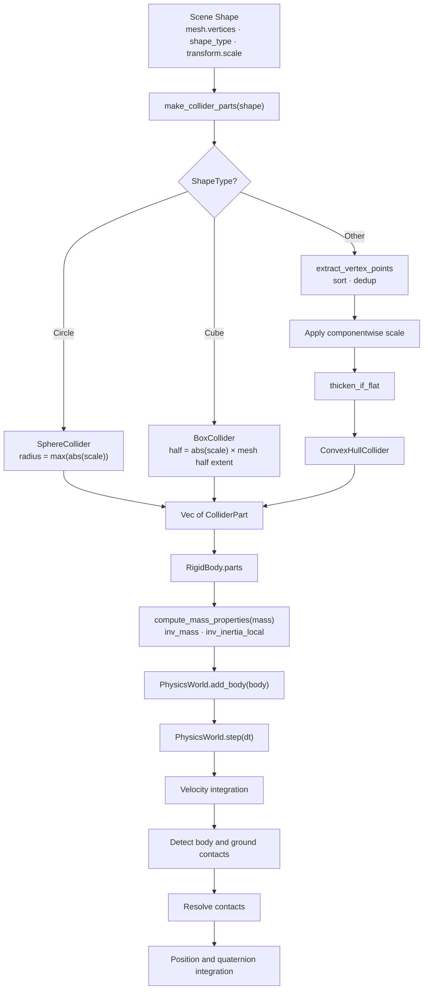
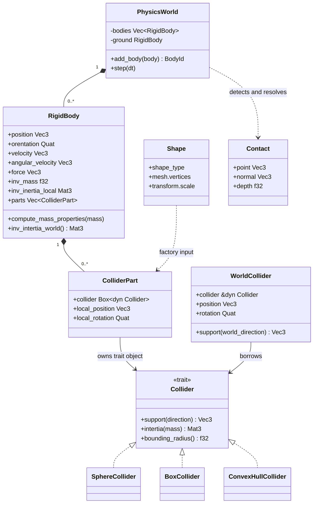
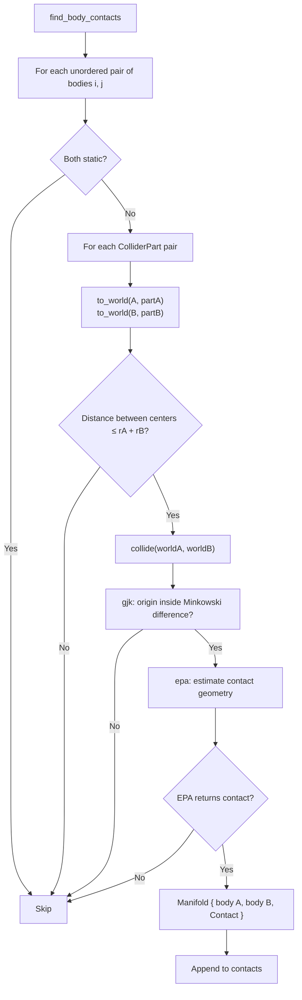
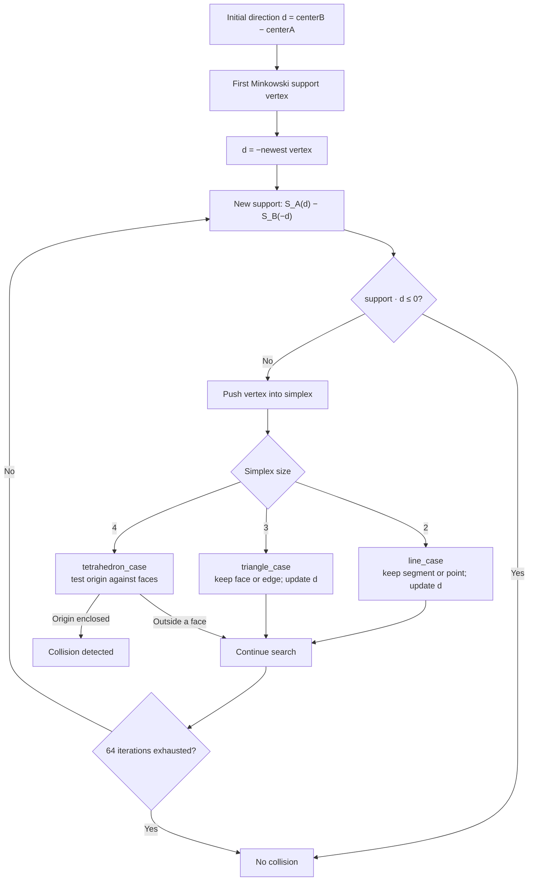
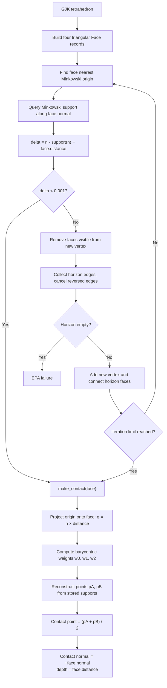
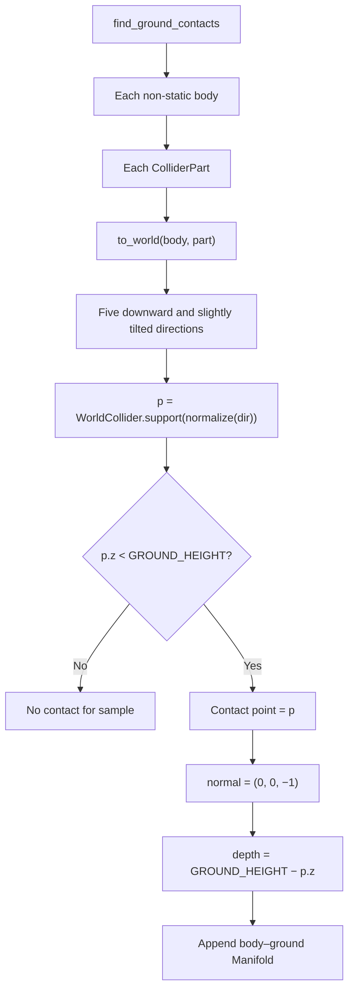
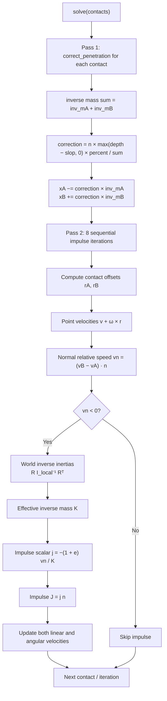
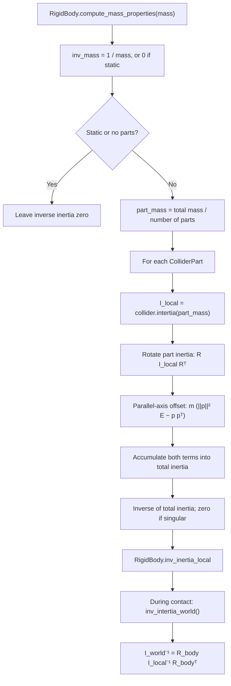
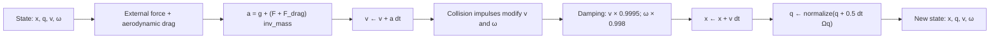

# Physics Pipeline — Visual Graphs (`sliyan_engine`)

This companion to `physics_pipeline.md` visualizes the **actual code architecture**, **function calls**, **data flow**, and **mathematics** in the Rust rigid-body engine. The diagrams use [Mermaid](https://mermaid.js.org/), which renders in compatible Markdown viewers (including GitHub).

> File names follow the proposed module layout (`collider_builder.rs`, `world_collider.rs`, `convex_collision.rs`); identifiers such as `orentation` and `intertia` retain their current spelling. A diagram arrow means *data flow* or *a function call*, as indicated in each section; it does not imply that every stage happens automatically.

## 1. Full pipeline — geometry to simulation



**Interpretation:** `make_collider_parts` returns colliders; the caller must attach them to a `RigidBody`, compute its mass properties, and add the body to `PhysicsWorld`.

## 2. Struct ownership and relationships



`WorldCollider` is a **temporary world-space view**, not a second owner of the collider. `Contact` is the collision result used by the solver.

## 3. Exact order of one simulation step

```mermaid
sequenceDiagram
    participant Caller
    participant World as PhysicsWorld
    participant Bodies as RigidBody collection
    participant Collision as GJK / EPA
    participant Solver as Contact solver
    Caller->>World: step(dt)
    World->>Bodies: integrate_velocities(dt)
    Note over Bodies: v += [g + (F + F_drag)/m] dt
    World->>World: find_body_contacts(out)
    loop each body pair and collider-part pair
        World->>World: to_world(body, part)
        Note over World: bounding sphere rejection
        World->>Collision: collide(worldA, worldB)
        Collision-->>World: Option<Contact>
    end
    World->>World: find_ground_contacts(out)
    Note over World: downward support samples vs z = 0
    World->>Solver: solve(contacts)
    loop each contact (once)
        Solver->>Bodies: correct_penetration(A, B, contact)
    end
    loop 8 solver iterations
        loop each contact
            Solver->>Bodies: resolve_contact(A, B, contact)
        end
    end
    World->>Bodies: integrate_positions(dt)
    Note over Bodies: damping; x += v dt; normalize updated q
    World-->>Caller: return
```

**Important order detail:** contact detection happens **after velocity integration but before position integration** in this implementation. Position correction is applied before the eight impulse passes.

## 4. Body–body collision detection: broadphase → GJK → EPA



**Broadphase sphere test:** `||xA − xB|| ≤ RA + RB`. This is a rejection test; passing it does not prove intersection.

## 5. GJK — simplex decision loop



**Minkowski support equation:** `S_(A−B)(d) = S_A(d) − S_B(−d)`.

**Line search direction:** `d = (AB × AO) × AB`.

**Triangle face normal:** `n = AB × AC`.

**GJK criterion:** intersection corresponds to `0 ∈ A−B` for intersecting convex sets. The code's numerical stopping conditions can produce false negatives in difficult or degenerate cases.

## 6. EPA — penetration and contact reconstruction



**Barycentric interpolation:** `q = w0 A + w1 B + w2 C`, with `w0 + w1 + w2 = 1`.

**Contact reconstruction:** `pA = Σ wi · supportA_i`, `pB = Σ wi · supportB_i`, `point = (pA + pB)/2`.

The normal shown is the **current code's convention** (`-face.normal`), not a claim that its sign is correct for every collision configuration. The solver expects a normal from body A toward body B.

## 7. Ground contacts — separate from GJK/EPA



The ground is represented by a **static `RigidBody` in the solver**, but ground contacts are generated analytically from support points and the plane `z = 0`, rather than by running GJK against a ground collider.

## 8. Contact solver — position and velocity



**Contact-point velocity:** `v_contact = v_center + ω × r`.

**Effective inverse mass:**

```text
K = inv_mA + inv_mB
  + n · [ (IA_inv (rA × n)) × rA
        + (IB_inv (rB × n)) × rB ]
```

**Impulse:** `j = −(1 + e) vn / K`, `J = j n`.

**Linear and angular updates:** `Δv = ±inv_m J`, `Δω = ±I_world⁻¹ (r × J)`.

There is no tangential/friction impulse in the current `resolve_contact` function.

## 9. Mass properties and inertia — calculation graph



**Assumptions:** every collider part receives equal mass; collider inertia is evaluated about its local origin; and the body's reference origin is treated as its center of mass. Convex hull inertia is approximated by its axis-aligned bounding box.

## 10. Per-frame dynamics equations



```text
F_drag = −(1/2) ρ Cd A |v| v, with ρ = 1.2
Ω = quaternion(0, ωx, ωy, ωz)
q_next = normalize(q + (dt/2) Ωq)
```

The quaternion multiplication order `Ωq` assumes **world-space angular velocity**. Damping factors are per-step constants, so changing the simulation timestep changes their effective damping rate.

## 11. Code map — where each stage lives

| Stage | Structs / functions | Current source |
|---|---|---|
| Geometry | `Collider`, `SphereCollider`, `BoxCollider`, `ConvexHullCollider` | `collider.rs` |
| Collider creation | `ColliderPart`, `extract_vertex_points`, `thicken_if_flat`, `make_collider_parts` | `collider_builder.rs` |
| World-space support | `WorldCollider::support` | `world_collider.rs` |
| GJK | `minkowski`, `Simplex`, `line_case`, `triangle_case`, `tetrahedron_case`, `gjk` | `convex_collision.rs` |
| EPA | `Face`, `make_face`, `make_contact`, `find_closest_face`, `epa` | `convex_collision.rs` |
| Contact API | `Contact`, `collide` | `convex_collision.rs` |
| Mass properties | `RigidBody::compute_mass_properties`, `inv_intertia_world` | `rigid_body.rs` |
| Simulation | `PhysicsWorld::step`, `integrate_velocities`, `integrate_positions` | `physics_world.rs` |
| Contact generation | `find_body_contacts`, `find_ground_contacts`, `to_world` | `physics_world.rs` |
| Contact resolution | `solve`, `resolve_contact`, `correct_penetration` | `physics_world.rs` |

## 12. Implementation caveats worth keeping in mind

- **GJK tetrahedron face normals:** `tetrahedron_case` uses cross products without checking each normal against the opposite tetrahedron vertex. Incorrect orientation can cause false intersection results.
- **Contact normal convention:** EPA returns `-face.normal`, while the impulse solver expects A → B. Confirm the convention using simple test cases before relying on the resulting impulses.
- **Multiple ground samples:** nearby support directions may generate duplicate contacts, affecting the number of corrections and impulses.
- **No continuous collision detection:** contacts are sampled at discrete steps; fast bodies can tunnel through thin geometry.
- **No friction or persistent contact cache:** the solver handles normal impulses only and rebuilds contacts every step.

## References

- [GJK collision detection](https://en.wikipedia.org/wiki/Gilbert%E2%80%93Johnson%E2%80%93Keerthi_distance_algorithm)
- [Minkowski addition and difference](https://en.wikipedia.org/wiki/Minkowski_addition)
- [Support functions](https://en.wikipedia.org/wiki/Support_function)
- [EPA walkthrough](https://winter.dev/articles/epa-algorithm/)
- [Sequential impulses — Erin Catto](https://box2d.org/files/ErinCatto_SequentialImpulses_GDC2006.pdf)
- [Parallel-axis theorem](https://en.wikipedia.org/wiki/Parallel_axis_theorem)
- [Rigid-body dynamics](https://en.wikipedia.org/wiki/Rigid_body_dynamics)
